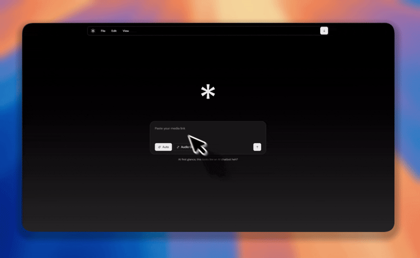

  

  <h1 align=center>grips</h1>
  

    <b>A (yet another) web downloader that uses <a href="https://github.com/yt-dlp/yt-dlp">yt-dlp</a> with a clean appearance</b>.
  

  
The backend is written in Go and the web uses the Sveltekit 5 framework.

  

    <a href="/web">web tree</a>
     • 
    <a href="/CHANGELOG.md">changelog</a>
     • 
    <a href="/web/history.md">history</a
  

  
  <a href="https://grips.vercel.app">Get Started ↗</a>

  

### features

- **Download queue**: Downloads are performed simultaneously, not one at a time.
- **Playlist support**: You can select which videos/audio files you want to download.
- **Prefer H264 and AAC codecs**: reduces failures when importing media into editing software.

### issue

grips works well enough, but issues will still occur in the future. Open a new issue if you encounter any issues while downloading, but don't forget to include detailed error logs, which can be found in the error messages on the web.

Feature requests are also welcome; let me know what you think.

### contributing

Contributions are very welcome, use conventional commits and don't make unnecessary changes, focus on what you want to fix or add.

### acknowledgments

- [yt-dlp](https://github.com/yt-dlp/yt-dlp) of course, the grips downloader relies on this amazing tool.
- [azhimaworks](https://discord.gg/mqD89tqUE) has been a sponsor and supports this project.
